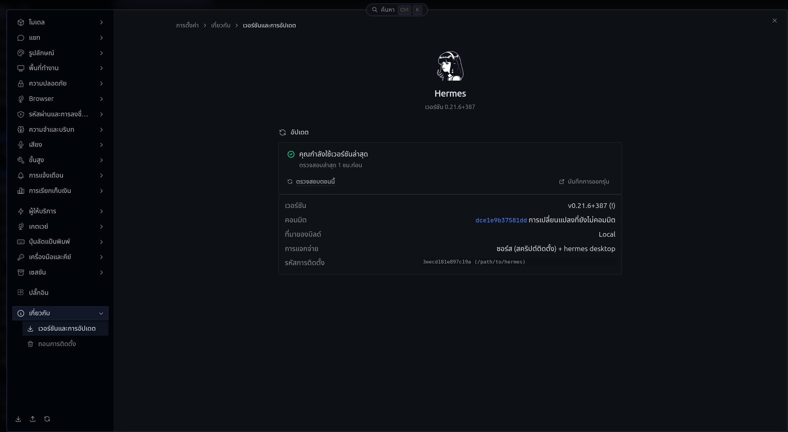

# hermes-lang-thai



Thai (ภาษาไทย) language pack for [Hermes Agent](https://github.com/NousResearch/hermes-agent).

Translates the Hermes Desktop UI to Thai. Currently covers **5,024 / 5,030 keys** of the
Desktop catalog. The remaining 6 keys use English fallback because they need
arrays or conditional logic that the YAML overlay format cannot express —
they are listed in [Known limitations](#known-limitations) below.

## Install

```bash
hermes plugins install shoesroom13/hermes-lang-thai
hermes config set display.language th
```

Restart any running gateway or TUI so they pick up the pack. The Desktop
app picks up the language immediately when you switch it in Settings.

## What is translated

| Surface | Status | Keys |
|---------|--------|------|
| Desktop | Translated | 5,024 / 5,030 |
| CLI / gateway | Not yet | 0 |
| TUI (`hermes --tui`) | Not yet | 0 |

## Known limitations

Six keys fall back to English because the YAML overlay format only supports
plain text and positional `{0}` placeholders, not arrays or conditionals:

| Key | Type | Impact |
|-----|------|--------|
| `composer.newSessionPlaceholders` | Array | English placeholder suggestions in a new chat |
| `composer.followUpPlaceholders` | Array | English placeholder suggestions in a follow-up |
| `ui.sidebar.toggle` | Conditional function | English "Show/Hide sidebar" tooltip |
| `sidebar.projects.toggle` | Conditional function | English "Show/Hide sessions" label |
| `sidebar.projects.branchOff` | Object-returning function | English "branch off" label in branch picker |
| `intro.custom` | Array-returning function | English fallback intro text (main intro still works) |

These can be resolved by contributing Thai to the bundled catalogs in the
upstream repo (`apps/desktop/src/i18n/th.ts`), which supports the full
TypeScript catalog shape.

## Contributing

Found a typo or want to add a missing key? Open an issue or a pull request.
The `locales/th.desktop.yaml` file is a flat nested YAML — edit the Thai
value in place and keep the structure unchanged.

## License

MIT — see [LICENSE](LICENSE).
